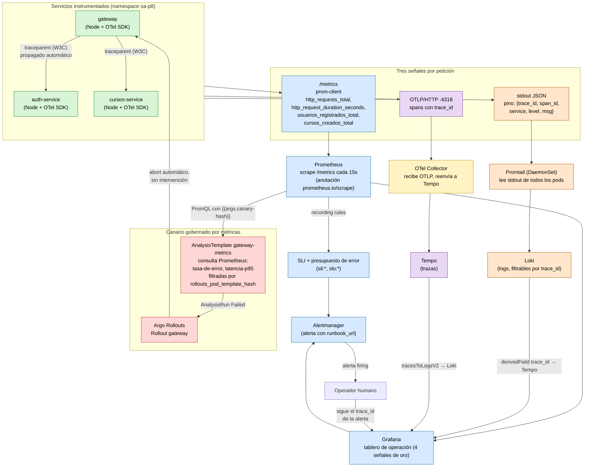

# Diagrama del flujo de telemetría

Recorrido de una señal desde el servicio hasta el tablero y la alerta, y de un fallo hasta su causa.

## Dos recorridos distintos, documentados en P10/evidencias/

1. **Síntoma → causa (operador humano, con alerta):** `FAULT_INJECTION=true` en auth-service → alerta
   `TasaErrorAuthServiceElevada` (Prometheus/Alertmanager) → traza con error en Tempo → registro con ese
   `trace_id` en Loki → causa confirmada. Ver `evidencias/sintoma-a-causa.md`.
2. **Canario → reversión automática (sin operador):** `CANARY_FAULT_INJECTION=true` en gateway → Argo Rollouts
   despliega la revisión como canario → `AnalysisTemplate gateway-metrics` consulta Prometheus filtrando por la
   revisión canaria → `AnalysisRun` falla → Argo Rollouts aborta solo. Ver `evidencias/canary-metricas.md`.
